# POC: Replace Webex links in on-premises Exchange meetings with Teams links

## 1. POC outcome and design

```mermaid
flowchart LR
    A[targets.csv and UTC window] --> B[1. fetch_webex_meeting.ps1]
    B -->|per-user export CSVs| C[output/]
    C --> D[2. create_teams_meeting_link.ps1]
    D -->|Graph createOrGet and per-user prepared CSVs| E[prepared/]
    E -->|review and approve rows| F[3. update_webex_meeting.ps1]
    F -->|EWS replace URL and send update| G[On-prem Exchange SE]
    G -->|Updated invitation| H[Meeting attendees]
```

The workflow uses three scripts and CSV handoffs. First create `targets.csv`, then `fetch_webex_meeting.ps1` exports each targeted user's calendar to `output/<email>-webex-export.csv`. Next, `create_teams_meeting_link.ps1` uses Microsoft Graph `onlineMeeting:createOrGet` to create or retrieve links and writes `prepared/<email>.csv`. After reviewing that file and approving individual rows, `update_webex_meeting.ps1` replaces the selected Webex URL in the corresponding on-premises event and sends updated invitations. The API is keyed to the Teams user, while the calendar event stays on-premises; this fit is an inference from the API request model, so prove it with one pilot organizer before processing more meetings. [Graph `createOrGet`](https://learn.microsoft.com/en-us/graph/api/onlinemeeting-createorget?view=graph-rest-1.0)



This is a link replacement workflow. Microsoft's Graph `onlineMeeting` API explicitly says the created meeting does not appear on the user's calendar. The Teams meeting object and the on-premises Exchange event therefore remain separate objects: the join link works from the updated invite, but this does not make the Exchange item a fully native Teams calendar event or provide Teams-calendar synchronization/chat association. This is an inference from the API's separate `onlineMeeting` resource and its calendar limitation. [Graph `createOrGet`](https://learn.microsoft.com/en-us/graph/api/onlinemeeting-createorget?view=graph-rest-1.0), [choosing an online-meeting API](https://learn.microsoft.com/en-us/graph/choose-online-meeting-api)

HMA supports EWS as a protocol. For this POC, the included script uses an on-premises EWS service account with Windows authentication and Exchange impersonation scoped to the pilot mailboxes. This avoids assuming that the Exchange Online EWS OAuth sample applies directly to on-premises Exchange. If your EWS virtual directory does not allow Windows authentication, use the dedicated HMA application/certificate pattern supported for on-premises EWS and validate the exact token audience and app authorization against your Exchange SE build before using it. HMA configuration is not itself a grant of mailbox access. [HMA protocol support and prerequisites](https://learn.microsoft.com/en-us/microsoft-365/enterprise/configure-exchange-server-for-hybrid-modern-authentication), [Microsoft HMA app pattern for on-premises Exchange](https://learn.microsoft.com/en-us/power-platform/admin/connect-exchange-server-onprem-hma)

## 2. POC boundaries

Start with a few test users and future organizer-owned meetings. The script supports both single-instance meetings and recurring series. It scans the item body and Location field for Webex URLs and prefers scheduled join links in the `j.php?MTID=...` form. URLs with the same MTID in that join-link group are treated as variants of one meeting link; all selected variants are replaced. A `globalcallin.php` URL may carry a different MTID for call-in information and is left unchanged. Different MTID values among `j.php` join links require manual review. If there is no `j.php` join link with an MTID, the script uses a unique MTID or proceeds only when exactly one distinct Webex URL was found; multiple URLs without a unique MTID require manual review. The report's `WebexUrlSource` column shows `Body`, `Location`, or `Body+Location`; `WebexUrlDiagnostics` marks `JoinUrl` versus `Other`, lists each source and parsed MTID, and identifies any other Webex URLs left unchanged. For a recurring series, EWS calendar expansion finds an occurrence in the requested window, the script binds to its recurring master, and updates the master once; all occurrences in the series use one shared Teams URL. It skips attendee copies, cancelled meetings, items with no Webex URL, and meetings already containing a Teams URL. The script does not interpret Webex-specific dial-in blocks, custom fields, or every Cisco invite template. Review candidate invites and generated invite text manually.

Start recurring coverage with a simple series without modified occurrences. If a series has modified occurrences (exceptions), the script marks it in the report but updates only the recurring master; it does not rewrite exception bodies independently. After applying, inspect each exception invite and manually replace any remaining Webex URL before treating the series as migrated. EWS expands recurring series into occurrences for calendar views and updates the recurring master to apply changes to a series. [EWS recurrence views](https://learn.microsoft.com/en-us/exchange/client-developer/exchange-web-services/recurrence-patterns-and-ews), [updating a recurring series](https://learn.microsoft.com/en-us/exchange/client-developer/exchange-web-services/how-to-update-a-recurring-series-by-using-ews-in-exchange)

The script creates one standalone Graph meeting object and reuses its join URL for the whole series. Microsoft documents a 60-day expiry after the meeting's start or end, extended by another 60 days if the meeting is updated or activated before it expires. Recurring series with gaps longer than 60 days need additional validation and may need the link regenerated. [Graph onlineMeeting lifetime](https://learn.microsoft.com/en-us/graph/api/resources/onlinemeeting?view=graph-rest-1.0)

This creates a new Teams meeting and substitutes its join URL. It does not migrate Webex meeting IDs, host keys, dial-in details, registration, recordings, attendance data, or Webex policies. Treat the attendee update as a new Teams join instruction and validate the Teams meeting policy separately.

Stage 1 is read-only and reports candidate meetings per user. Stage 2 creates/retrieves Teams links but does not change Exchange. Stage 3 updates only prepared rows whose `Status` is `ReadyForUpdate` and whose `ApprovedForUpdate` value is `Yes`. It checks that the Exchange change key and selected Webex URL still match the fetched event. `update_webex_meeting.ps1 -Mode Rollback` restores the backed-up body and Location for items changed by stage 3 and sends another update to attendees; it skips an item if either field differs from the saved post-update value. Reports include detected Webex join URLs and parsed MTIDs, while backups contain meeting body and Location content; store both in an access-controlled location and delete them according to your retention rules after the POC.

Use UTC timestamps for the scan window. Avoid meetings already in progress or close to their start. Have the test organizer run a real meeting with internal and external attendees and verify the join/lobby policy before broadening the pilot.

## 3. Requirements

### Exchange / identity / network

- Exchange Server Subscription Edition is in a supported hybrid state, EWS is enabled for the pilot mailboxes, and all Exchange servers are consistently configured for HMA if HMA is in use. HMA supports EWS; the script still needs an EWS authentication method accepted by the endpoint.
- For Teams' on-premises mailbox integration, the users must be synchronized to Entra ID and have the required Teams license; Exchange Autodiscover/EWS must be published externally and hybrid OAuth configured. Microsoft lists Exchange 2016 CU3 or later for this integration, which Exchange SE exceeds, and calls out the Exchange hybrid deployment feature in Entra Connect. For Teams calendar app and Outlook add-in support, the Exchange EWS URLs also need to be registered as SPNs on the Exchange service principal. These are separate prerequisites from granting the POC app permission to create a standalone meeting link. [Teams and Exchange interaction requirements](https://learn.microsoft.com/en-us/microsoftteams/exchange-teams-interact)
- Microsoft recommends Exchange Online enablement for the full Teams experience, but the on-premises meeting integration prerequisites specifically call for a Teams license and hybrid/EWS/OAuth configuration. Confirm the actual license SKU and any separate Exchange Online licensing requirements with your licensing owner; do not add mailbox/calendar API permissions to the POC app to address licensing. [Teams and Exchange interaction overview](https://learn.microsoft.com/en-us/microsoftteams/exchange-teams-interact)
- The machine running the script can resolve and reach the on-premises EWS URL over HTTPS and trusts its certificate. For the included Windows-auth example, the EWS virtual directory must accept the chosen Windows authentication scheme (typically negotiate/NTLM) from that machine. If the runner uses a web proxy, the EWS route must either bypass it or authenticate to it.
- A dedicated, enabled on-premises AD service account for EWS. Do not use an Exchange admin account.
- A test mailbox allowlist and a matching Entra object ID for each organizer. Each organizer must be represented in Entra ID, enabled for Teams, and licensed/configured to create Teams meetings.
- EWS Managed API 2.2 assembly available from an approved source. The Microsoft EWS Managed API repository is archived; it is used here only as a small POC client wrapper. [Repository](https://github.com/OfficeDev/ews-managed-api)
- PowerShell 5.1 on Windows, the `Microsoft.Graph.Authentication` PowerShell module, and either an app certificate available to the Windows account that runs the script or a client secret for the Graph app.

### App registration and permissions

Use a dedicated single-tenant Graph app registration. Choose certificate or client-secret authentication for the app; both use the same Graph permissions below. Certificates are the recommended credential for production, while a client secret can be useful for a controlled POC. Add only:

| API | Permission | Type | Purpose |
| --- | --- | --- | --- |
| Microsoft Graph | `OnlineMeetings.ReadWrite.All` | Application | Create/get the Teams online-meeting object and obtain `joinWebUrl`. Admin consent required. |

Do not grant Graph `Calendars.ReadWrite`, `Mail.ReadWrite`, or directory-wide read permission for this workflow. The script takes each Entra object ID from the CSV, so it does not need to look up users. `createOrGet` with an application token requires a Teams application access policy granting the app access on behalf of the organizer. [API permissions and policy requirement](https://learn.microsoft.com/en-us/graph/api/onlinemeeting-createorget?view=graph-rest-1.0), [application access policy setup](https://learn.microsoft.com/graph/cloud-communication-online-meeting-application-access-policy)

For EWS, the service account needs the `ApplicationImpersonation` role, scoped to the pilot mailboxes. EWS impersonation can otherwise grant mailbox-wide reach, so use a recipient scope. Microsoft recommends a scope for on-premises impersonation. [EWS impersonation security](https://learn.microsoft.com/en-us/exchange/client-developer/exchange-web-services/impersonation-and-ews-in-exchange)

### Minimum operational roles

- Entra admin for the one-time Graph app permission/admin consent and credential configuration.
- Teams admin (or an admin role permitted to manage Teams application access policies) for the policy and per-user grants.
- Exchange organization admin for the one-time scoped impersonation role assignment and EWS configuration checks.
- Script operator: read the target CSV, access the selected Graph credential (certificate private key or client secret), and authenticate as the EWS service account. No permanent Exchange administrator role is needed for the operator.

## 4. One-time setup

### Step 1 — Confirm the test scope

1. Select 2–5 test organizers whose mailboxes are on-premises and who are enabled/licensed for Teams.
2. Choose a future UTC scan window, for example the next 14 days.
3. Use one-off test meetings first, then a simple recurring test series with at least two occurrences in the scan window. Include only meetings where the test mailbox is the organizer and where sending updates to attendees is acceptable.
4. Create a protected working folder for the script, CSV, report, and backup. Reports contain Webex join URLs and MTIDs; backups store original message bodies and Location text.

### Step 2 — Create and authorize the Graph app

1. Register a single-tenant application, for example `WebexTeamsMeetingUrlPOC`.
2. Configure one or both Graph credential methods on the same app registration; stage 2's `-GraphAuthMethod` parameter selects the authentication method:

   **Certificate (default script option):** Sign in to the POC runner as the same Windows account that will run the script. Create a self-signed certificate in that account's `CurrentUser\My` store. This is suitable for the POC; use your organization's approved PKI certificate process for production.

   ```powershell
   $cert = New-SelfSignedCertificate `
     -Subject "CN=WebexTeamsMeetingUrlPOC" `
     -CertStoreLocation "Cert:\CurrentUser\My" `
     -KeyAlgorithm RSA `
     -KeyLength 2048 `
     -HashAlgorithm SHA256 `
     -KeySpec Signature `
     -KeyExportPolicy NonExportable `
     -NotAfter (Get-Date).AddMonths(12)

   $publicCertPath = Join-Path $PWD "WebexTeamsMeetingUrlPOC.cer"
   Export-Certificate -Cert $cert -FilePath $publicCertPath | Out-Null

   $cert | Format-List Subject, Thumbprint, NotAfter, HasPrivateKey
   Write-Host "Upload this public certificate file: $publicCertPath"
   ```

   This keeps the private key in the Windows certificate store and exports only the public `.cer` file. Keep the thumbprint for the script. If a different Windows account or runner will execute the script, create/install a corresponding certificate for that run-as identity and upload its public certificate; the account must be able to read the private key.

   In the Entra admin center, open **App registrations** > your POC app > **Certificates & secrets** > **Certificates** > **Upload certificate**. Select `WebexTeamsMeetingUrlPOC.cer` and add it. Upload only the `.cer`; do not upload or distribute a private key.

   **Client secret (alternative):** In the Entra admin center, open **App registrations** > your POC app > **Certificates & secrets** > **Client secrets** > **New client secret**. Choose an expiry that follows your organization's policy, create the secret, and copy its **Value** immediately into your approved password manager. The first Graph-authenticated stage 2 run in `ClientSecret` mode prompts for it with hidden input, then saves it encrypted with Windows DPAPI after Graph authentication succeeds. Later runs reuse `%LOCALAPPDATA%\WebexTeamsPOC\graph-client-secret.xml` without prompting, under the same Windows account on the same computer. Do not put the secret in the script, command line, CSV, or logs. If the secret rotates, delete this cache so the script prompts for the new value. Client secrets expire and are less secure than certificates; use a certificate or managed/federated credential for production.

3. Add Microsoft Graph **Application** permission `OnlineMeetings.ReadWrite.All`; grant admin consent.
4. Record the tenant ID and app/client ID, plus the certificate thumbprint if using certificate authentication. Do not put private-key or client-secret material in the script or CSV.
5. Do not add Graph Calendar or Mail permissions.

On the runner, install the approved PowerShell modules if they are not already present:

```powershell
Install-Module Microsoft.Graph.Authentication -Scope CurrentUser
Install-Module MicrosoftTeams -Scope CurrentUser
```

For certificate authentication, confirm that the certificate and private key are available to the current Windows account, then test app-only Graph authentication:

```powershell
$thumbprint = "<CERTIFICATE-THUMBPRINT>"
$cert = Get-Item "Cert:\CurrentUser\My\$thumbprint"
$cert | Format-List Subject, Thumbprint, NotAfter, HasPrivateKey

Connect-MgGraph `
  -TenantId "<TENANT-ID>" `
  -ClientId "<GRAPH-APP-CLIENT-ID>" `
  -CertificateThumbprint $thumbprint `
  -ContextScope Process `
  -NoWelcome

Get-MgContext | Format-List AuthType, TenantId, ClientId, CertificateThumbprint
Disconnect-MgGraph
```

Confirm `HasPrivateKey` is `True` and `AuthType` is `AppOnly`. For client-secret authentication, the stage 2 script handles the hidden first-use prompt and caches the secret only after the Graph connection succeeds. Stage 1 and stage 3 do not require Graph authentication. [Graph PowerShell app-only authentication](https://learn.microsoft.com/en-us/powershell/microsoftgraph/app-only?view=graph-powershell-1.0), [Connect-MgGraph authentication options](https://learn.microsoft.com/en-us/powershell/module/microsoft.graph.authentication/connect-mggraph?view=graph-powershell-1.0)

### Step 3 — Limit Graph meeting API access to the pilot organizers

In Teams PowerShell, create a policy with the Graph app's client ID and grant it only to the pilot users. Example (run once, with actual IDs):

```powershell
Connect-MicrosoftTeams

New-CsApplicationAccessPolicy `
  -Identity "WebexTeamsUrlPOC" `
  -AppIds "<GRAPH-APP-CLIENT-ID>" `
  -Description "Allow the POC app to create Teams meetings for pilot organizers only"

Grant-CsApplicationAccessPolicy `
  -PolicyName "WebexTeamsUrlPOC" `
  -Identity "pilot.organizer@contoso.com"

Grant-CsApplicationAccessPolicy `
  -PolicyName "WebexTeamsUrlPOC" `
  -Identity "pilot.organizer2@contoso.com"
```

Do not use `-Global`. Application access policy changes can take up to 30 minutes to be reflected in Graph. [Microsoft policy cmdlet](https://learn.microsoft.com/en-us/powershell/module/microsoftteams/grant-csapplicationaccesspolicy?view=teams-ps), [policy propagation and API requirements](https://learn.microsoft.com/graph/cloud-communication-online-meeting-application-access-policy)

### Step 4 — Scope EWS impersonation to test mailboxes

In on-premises Exchange Management Shell, mark the pilot mailboxes with a dedicated custom attribute, create a recipient scope, and assign impersonation to the dedicated service account. First save the prior `CustomAttribute15` values so you can restore them later.

```powershell
# Save current values before changing them.
Get-Mailbox pilot.organizer@contoso.com,pilot.organizer2@contoso.com |
  Select-Object PrimarySmtpAddress,CustomAttribute15 |
  Export-Csv .\webex-teams-poc-original-attributes.csv -NoTypeInformation

Set-Mailbox pilot.organizer@contoso.com  -CustomAttribute15 "WebexTeamsUrlPOC"
Set-Mailbox pilot.organizer2@contoso.com -CustomAttribute15 "WebexTeamsUrlPOC"

New-ManagementScope `
  -Name "WebexTeamsUrlPOCMailboxes" `
  -RecipientRestrictionFilter "RecipientTypeDetails -eq 'UserMailbox' -and CustomAttribute15 -eq 'WebexTeamsUrlPOC'"

New-ManagementRoleAssignment `
  -Name "WebexTeamsUrlPOCImpersonation" `
  -Role ApplicationImpersonation `
  -User "CONTOSO\svc_webex_teams_poc" `
  -CustomRecipientWriteScope "WebexTeamsUrlPOCMailboxes"

# Verify the scope includes only the intended pilot mailbox recipients.
$scope = Get-ManagementScope "WebexTeamsUrlPOCMailboxes"
Get-Recipient -RecipientPreviewFilter $scope.RecipientFilter |
  Select-Object PrimarySmtpAddress,RecipientTypeDetails,CustomAttribute15
```

If this role assignment or scope already exists, inspect and validate it rather than creating a duplicate. Exchange scopes are defined with OPATH recipient filters. [New-ManagementScope reference](https://learn.microsoft.com/en-us/powershell/module/exchangepowershell/new-managementscope?view=exchange-ps)

### Step 5 — Confirm EWS works before changing invites

1. Confirm the EWS URL (for example `https://mail.contoso.com/EWS/Exchange.asmx`) is the correct externally or internally reachable endpoint for the runner.
2. In on-premises Exchange Management Shell, inspect the EWS URL/authentication settings and pilot mailbox EWS setting:

   ```powershell
   Get-WebServicesVirtualDirectory |
     Format-List Identity,InternalUrl,ExternalUrl,WindowsAuthentication,OAuthAuthentication

   Get-CASMailbox pilot.organizer@contoso.com |
     Format-List EwsEnabled
   ```

   Keep server authentication consistent with your security baseline; do not enable Basic authentication just for this POC.
3. Sign in to the runner using the POC operator account, then run `fetch_webex_meeting.ps1` for one mailbox and a narrow date window.
4. If EWS rejects the service account, confirm the endpoint's Windows-auth settings, the impersonation assignment, the recipient scope, firewall/reverse-proxy rules, and the mailbox's EWS access setting. Do not broaden the role assignment to the whole organization as a troubleshooting shortcut.
5. If Windows authentication is unavailable, stop here and validate the dedicated HMA app/certificate path for this Exchange SE organization. The HMA app-only pattern uses the Office 365 Exchange Online `full_access_as_app` application permission and can be further scoped with Exchange impersonation; the details are not interchangeable with Graph permissions. [HMA app pattern](https://learn.microsoft.com/en-us/power-platform/admin/connect-exchange-server-onprem-hma)

### Step 6 — Prepare the target CSV

Add the pilot organizer addresses to `pilot-mailboxes.csv`. `MailboxSmtp` is the on-premises primary SMTP address. `EntraUserPrincipalName` is optional; supply it if the SMTP address is an alias or does not match the user's Entra sign-in name.

```csv
MailboxSmtp,EntraUserPrincipalName
pilot.organizer@contoso.com,
pilot.organizer2@contoso.com,pilot.organizer2@contoso.com
```

Resolve the Entra object IDs and generate `targets.csv`:

```powershell
Install-Module Microsoft.Graph.Users -Scope CurrentUser
.\scripts\New-TargetsCsv.ps1 -InputCsv ".\pilot-mailboxes.csv" -OutputCsv ".\targets.csv" -Force
```

The helper signs in interactively with delegated, read-only `User.ReadBasic.All` to look up the users' basic profiles, including ID, mail, and UPN. This permission is used only by the helper and does not need to be added to the POC's Teams meeting app. Inspect the generated IDs before using the file. [Graph list users permissions](https://learn.microsoft.com/en-us/graph/api/user-list?view=graph-rest-1.0), [User.ReadBasic.All profile fields](https://learn.microsoft.com/en-us/graph/permissions-reference)

## 5. Run the POC

### Step 7 — Fetch Webex meetings (stage 1)

The three conversion scripts pass data through per-user CSV files. Generate `targets.csv` with the reviewed `MailboxSmtp,EntraObjectId` rows. For the first end-to-end test, keep one organizer in this file; after it succeeds, add the remaining approved organizers. Choose one finite UTC window for the batch and use the same window when rerunning stage 1. A recurring series that has an occurrence in the selected window is exported once and the update stage changes its master.

```powershell
$batchStart = [DateTimeOffset]::UtcNow
$batchEnd = $batchStart.AddDays(30)
$ewsUrl = "https://mail.contoso.com/EWS/Exchange.asmx"
$ewsDll = "C:\Program Files\Microsoft\Exchange\Web Services\2.2\Microsoft.Exchange.WebServices.dll"

.\scripts\fetch_webex_meeting.ps1 `
  -EwsUrl $ewsUrl `
  -EwsManagedApiDll $ewsDll `
  -TargetsCsv ".\targets.csv" `
  -WindowStartUtc $batchStart `
  -WindowEndUtc $batchEnd `
  -OutputDirectory ".\output"
```

The first EWS run prompts for the service credential and saves it encrypted at `%LOCALAPPDATA%\WebexTeamsPOC\ews-credential.xml`. The cache is decryptable only by the same Windows user on the same computer. To replace a rotated credential, remove the cache and rerun:

```powershell
Remove-Item -LiteralPath "$env:LOCALAPPDATA\WebexTeamsPOC\ews-credential.xml"
```

The default EWS proxy mode is `Direct`, which avoids the HTTP 407 seen when an internal EWS endpoint was sent through a system proxy. If the approved route requires a proxy, pass `-EwsProxyMode System` or `-EwsProxyMode SystemDefaultCredentials`.

Stage 1 writes one file per target, for example `output\pilot.organizer@contoso.com-webex-export.csv`. Review the `Status`, subject, time, `MeetingScope`, `HasModifiedOccurrences`, `OriginalWebexUrl`, and `WebexUrlDiagnostics` fields. The diagnostics show each detected URL, source, and MTID, including duplicates. The script prefers the scheduled attendee join URL (`j.php?MTID=...`); a different MTID on a call-in (`globalcallin.php`) link can be expected. Only `ReadyForTeamsLink` rows move to stage 2. Resolve `SkippedMultipleMtidWebex` or other URL review statuses before proceeding. Protect the CSVs because they contain join URLs and meeting identifiers.

For an organization-wide estimate across user, shared, room, and equipment mailboxes, use the separate read-only [inventory report script](scripts/Report-WebexMeetingsInventory.ps1). Supply a mailbox list and a finite planning horizon, such as the next 12 months. It reports recurring series once when any occurrence lands in the window; it does not imply that meetings beyond that horizon were counted. The inventory is for sizing and is not the conversion input unless its rows are resolved to Teams-enabled organizers and Entra object IDs.

### Step 8 — Create Teams links and review the prepared CSVs (stage 2)

Run stage 2 on the `output` directory. It reads rows marked `ReadyForTeamsLink`, calls Graph `onlineMeeting:createOrGet`, and writes a matching per-user file such as `prepared\pilot.organizer@contoso.com.csv`. It does not read or modify Exchange. Rows that were skipped or need manual review are retained in the prepared CSV with their status.

Certificate authentication:

```powershell
.\scripts\create_teams_meeting_link.ps1 `
  -InputDirectory ".\output" `
  -OutputDirectory ".\prepared" `
  -GraphTenantId "<TENANT-ID>" `
  -GraphAppId "<GRAPH-APP-CLIENT-ID>" `
  -GraphAuthMethod Certificate `
  -GraphCertificateThumbprint "<CERTIFICATE-THUMBPRINT>"
```

For client-secret authentication, use `-GraphAuthMethod ClientSecret` and omit the certificate thumbprint. On first use, the script securely prompts for the secret and saves it encrypted at `%LOCALAPPDATA%\WebexTeamsPOC\graph-client-secret.xml` after Graph authentication succeeds. The cache is tied to the same Windows user and computer. Remove it after rotating the secret:

```powershell
Remove-Item -LiteralPath "$env:LOCALAPPDATA\WebexTeamsPOC\graph-client-secret.xml"
```

Review each prepared CSV. Confirm the selected Webex join URLs and diagnostics, meeting subject/time/scope, and `TeamsJoinUrl`. Set `ApprovedForUpdate` to `Yes` only for the rows to apply; leave other rows as `No`. Save the file. This is the row-by-row approval gate for stage 3. Do not change the EWS item ID/change key or URL fields. The Graph meeting objects are standalone; unused links may remain if you do not apply them, and Exchange rollback does not delete them.

### Step 9 — Update approved meetings (stage 3)

Start with one test organizer and one single-instance meeting with a test attendee. Set `-FilePattern` to only that user's prepared CSV. Use `*.csv` when you are ready to process every reviewed per-user file.

```powershell
.\scripts\update_webex_meeting.ps1 `
  -EwsUrl $ewsUrl `
  -EwsManagedApiDll $ewsDll `
  -InputDirectory ".\prepared" `
  -FilePattern "pilot.organizer@contoso.com.csv" `
  -OutputDirectory ".\applied" `
  -BackupPath ".\backups\pilot-update.jsonl"
```

The script updates only rows with both `Status=ReadyForUpdate` and `ApprovedForUpdate=Yes`. Unapproved rows are reported as `AwaitingApproval`. It checks that the Exchange change key matches the stage 1 export and that each selected Webex URL is still present. Changed items are skipped for a fresh fetch/review. Choose a new backup path for each apply run; the backup is written before the EWS update and contains the original body and Location. EWS sends an updated meeting request to attendees.

Confirm the result CSV under `applied` says `Applied` for the expected meetings. Check the organizer's Exchange event and confirm the attendee receives the update and can join Teams. Repeat with a recurring series that has no modified occurrences. If `HasModifiedOccurrences` is true, inspect exception invites manually; the script updates the recurring master only. Check the Teams lobby, anonymous-join, and external-attendee policies before expanding the batch.

### Step 10 — Roll back if needed

Use the JSONL backup created by stage 3. Rollback restores the saved body and Location if they still match the post-update values, then sends another attendee update. It reports changed items rather than overwriting later edits. It does not restore exception bodies edited manually or delete standalone Graph meetings.

```powershell
.\scripts\update_webex_meeting.ps1 `
  -Mode Rollback `
  -EwsUrl $ewsUrl `
  -EwsManagedApiDll $ewsDll `
  -BackupPath ".\backups\pilot-update.jsonl" `
  -OutputDirectory ".\applied" `
  -Force
```

If rollback is successful, restore the original `CustomAttribute15` values from the file exported during setup, then remove only the POC-owned Exchange scope/role assignment and Teams policy. Do not remove shared or pre-existing assignments.

## 6. Script files and execution notes

- Stage 1 EWS export: [scripts/fetch_webex_meeting.ps1](scripts/fetch_webex_meeting.ps1)
- Stage 2 Graph link creation: [scripts/create_teams_meeting_link.ps1](scripts/create_teams_meeting_link.ps1)
- Stage 3 Exchange update and rollback: [scripts/update_webex_meeting.ps1](scripts/update_webex_meeting.ps1)
- Shared helpers: [scripts/WebexTeams.Common.ps1](scripts/WebexTeams.Common.ps1)
- Target resolver: [scripts/New-TargetsCsv.ps1](scripts/New-TargetsCsv.ps1)
- Organization-wide sizing report: [scripts/Report-WebexMeetingsInventory.ps1](scripts/Report-WebexMeetingsInventory.ps1)
- `scripts/Convert-WebexMeetingsToTeams.ps1` is the earlier combined workflow; use the three stage scripts above for new batches.
- EWS `TimeZone` is read-only; the scripts set UTC through the `ExchangeService(ExchangeVersion, TimeZoneInfo)` constructor. The shared helper returns `PropertySet` as one object so PowerShell does not expand it into `Bind` or `Load` arguments.
- Graph `createOrGet` uses a deterministic external ID based on organizer, iCalendar UID, and the recurring master start time, so retrying the same prepared meeting retrieves the existing Teams link.
- Graph app access policy and EWS impersonation are separate controls. The Graph app policy does not grant EWS permissions.
- Do not use Graph Calendar API to access on-premises calendar items. EWS reads and updates these Exchange SE items; Graph is used only to create Teams meeting links. [Graph Outlook calendar data scope](https://learn.microsoft.com/en-us/graph/outlook-calendar-concept-overview)
