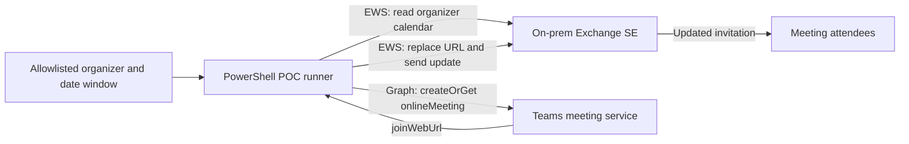

# POC: Replace Webex links in on-premises Exchange meetings with Teams links

## 1. POC outcome and design

For a tightly scoped pilot, use EWS against Exchange Server SE to find and update organizer-owned, single-instance calendar meetings in the on-premises mailboxes. For each eligible meeting, use Microsoft Graph `onlineMeeting:createOrGet` with the organizer's Entra object ID to create or retrieve a Teams join URL, then replace the one Webex URL in the event body and send an updated meeting request to its attendees. The API is keyed to the Teams user, while the calendar event stays on-premises; this fit is an inference from the API request model, so prove it with one pilot organizer before processing more meetings. [Graph `createOrGet`](https://learn.microsoft.com/en-us/graph/api/onlinemeeting-createorget?view=graph-rest-1.0)



This is a link replacement workflow. Microsoft's Graph `onlineMeeting` API explicitly says the created meeting does not appear on the user's calendar. The Teams meeting object and the on-premises Exchange event therefore remain separate objects: the join link works from the updated invite, but this does not make the Exchange item a fully native Teams calendar event or provide Teams-calendar synchronization/chat association. This is an inference from the API's separate `onlineMeeting` resource and its calendar limitation. [Graph `createOrGet`](https://learn.microsoft.com/en-us/graph/api/onlinemeeting-createorget?view=graph-rest-1.0), [choosing an online-meeting API](https://learn.microsoft.com/en-us/graph/choose-online-meeting-api)

HMA supports EWS as a protocol. For this POC, the included script uses an on-premises EWS service account with Windows authentication and Exchange impersonation scoped to the pilot mailboxes. This avoids assuming that the Exchange Online EWS OAuth sample applies directly to on-premises Exchange. If your EWS virtual directory does not allow Windows authentication, use the dedicated HMA application/certificate pattern supported for on-premises EWS and validate the exact token audience and app authorization against your Exchange SE build before using it. HMA configuration is not itself a grant of mailbox access. [HMA protocol support and prerequisites](https://learn.microsoft.com/en-us/microsoft-365/enterprise/configure-exchange-server-for-hybrid-modern-authentication), [Microsoft HMA app pattern for on-premises Exchange](https://learn.microsoft.com/en-us/power-platform/admin/connect-exchange-server-onprem-hma)

## 2. POC boundaries

Start with a few test users and only future, organizer-owned, single-instance meetings that contain exactly one Webex URL in the message body. The script skips recurring meetings, attendee copies, cancelled meetings, bodies with zero or multiple Webex URLs, and meetings already containing a Teams URL. It scans the body only; it does not interpret Webex-specific dial-in blocks, custom fields, meeting locations, or all Cisco invite templates. Review candidate invites and the generated invite text manually.

This creates a new Teams meeting and substitutes its join URL. It does not migrate Webex meeting IDs, host keys, dial-in details, registration, recordings, attendance data, or Webex policies. Treat the attendee update as a new Teams join instruction and validate the Teams meeting policy separately.

The script's default mode is `Preview`: it reads EWS items and reports candidates but does not create Graph meetings or change invitations. `Apply` creates/reuses the Teams meeting and updates the invite. `Rollback` restores the backed-up body for items changed by this script and sends another update to attendees. A backup contains meeting body content, so store it in an access-controlled location and delete it according to your retention rules after the POC.

Use UTC timestamps for the scan window. Avoid meetings already in progress or close to their start. Have the test organizer run a real meeting with internal and external attendees and verify the join/lobby policy before broadening the pilot.

## 3. Requirements

### Exchange / identity / network

- Exchange Server Subscription Edition is in a supported hybrid state, EWS is enabled for the pilot mailboxes, and all Exchange servers are consistently configured for HMA if HMA is in use. HMA supports EWS; the script still needs an EWS authentication method accepted by the endpoint.
- For Teams' on-premises mailbox integration, the users must be synchronized to Entra ID and have the required Teams license; Exchange Autodiscover/EWS must be published externally and hybrid OAuth configured. Microsoft lists Exchange 2016 CU3 or later for this integration, which Exchange SE exceeds, and calls out the Exchange hybrid deployment feature in Entra Connect. For Teams calendar app and Outlook add-in support, the Exchange EWS URLs also need to be registered as SPNs on the Exchange service principal. These are separate prerequisites from granting the POC app permission to create a standalone meeting link. [Teams and Exchange interaction requirements](https://learn.microsoft.com/en-us/microsoftteams/exchange-teams-interact)
- Microsoft recommends Exchange Online enablement for the full Teams experience, but the on-premises meeting integration prerequisites specifically call for a Teams license and hybrid/EWS/OAuth configuration. Confirm the actual license SKU and any separate Exchange Online licensing requirements with your licensing owner; do not add mailbox/calendar API permissions to the POC app to address licensing. [Teams and Exchange interaction overview](https://learn.microsoft.com/en-us/microsoftteams/exchange-teams-interact)
- The machine running the script can resolve and reach the on-premises EWS URL over HTTPS and trusts its certificate. For the included Windows-auth example, the EWS virtual directory must accept the chosen Windows authentication scheme (typically negotiate/NTLM) from that machine.
- A dedicated, enabled on-premises AD service account for EWS. Do not use an Exchange admin account.
- A test mailbox allowlist and a matching Entra object ID for each organizer. Each organizer must be represented in Entra ID, enabled for Teams, and licensed/configured to create Teams meetings.
- EWS Managed API 2.2 assembly available from an approved source. The Microsoft EWS Managed API repository is archived; it is used here only as a small POC client wrapper. [Repository](https://github.com/OfficeDev/ews-managed-api)
- PowerShell 5.1 on Windows, the `Microsoft.Graph.Authentication` PowerShell module, and an app certificate with its private key installed in the certificate store of the script runner.

### App registration and permissions

Use a dedicated single-tenant Graph app registration and certificate for the POC. Add only:

| API | Permission | Type | Purpose |
| --- | --- | --- | --- |
| Microsoft Graph | `OnlineMeetings.ReadWrite.All` | Application | Create/get the Teams online-meeting object and obtain `joinWebUrl`. Admin consent required. |

Do not grant Graph `Calendars.ReadWrite`, `Mail.ReadWrite`, or directory-wide read permission for this workflow. The script takes each Entra object ID from the CSV, so it does not need to look up users. `createOrGet` with an application token requires a Teams application access policy granting the app access on behalf of the organizer. [API permissions and policy requirement](https://learn.microsoft.com/en-us/graph/api/onlinemeeting-createorget?view=graph-rest-1.0), [application access policy setup](https://learn.microsoft.com/graph/cloud-communication-online-meeting-application-access-policy)

For EWS, the service account needs the `ApplicationImpersonation` role, scoped to the pilot mailboxes. EWS impersonation can otherwise grant mailbox-wide reach, so use a recipient scope. Microsoft recommends a scope for on-premises impersonation. [EWS impersonation security](https://learn.microsoft.com/en-us/exchange/client-developer/exchange-web-services/impersonation-and-ews-in-exchange)

### Minimum operational roles

- Entra admin for the one-time Graph app permission/admin consent and certificate configuration.
- Teams admin (or an admin role permitted to manage Teams application access policies) for the policy and per-user grants.
- Exchange organization admin for the one-time scoped impersonation role assignment and EWS configuration checks.
- Script operator: read the target CSV, read the certificate private key, and authenticate as the EWS service account. No permanent Exchange administrator role is needed for the operator.

## 4. One-time setup

### Step 1 — Confirm the test scope

1. Select 2–5 test organizers whose mailboxes are on-premises and who are enabled/licensed for Teams.
2. Choose a future UTC scan window, for example the next 14 days.
3. Use one-off test meetings first. Include only meetings where the test mailbox is the organizer and where sending an update to the attendees is acceptable.
4. Create a protected working folder for the script, CSV, report, and backup. The backup stores original message bodies.

### Step 2 — Create and authorize the Graph app

1. Register a single-tenant application, for example `WebexTeamsMeetingUrlPOC`.
2. Create/upload a certificate credential. Install the certificate with private key on the POC runner and grant private-key read to the account that runs the script.
3. Add Microsoft Graph **Application** permission `OnlineMeetings.ReadWrite.All`; grant admin consent.
4. Record tenant ID, app/client ID, and certificate thumbprint. Do not put a certificate password or private-key material in the script or CSV.
5. Do not add Graph Calendar or Mail permissions.

On the runner, install the approved PowerShell modules if they are not already present:

```powershell
Install-Module Microsoft.Graph.Authentication -Scope CurrentUser
Install-Module MicrosoftTeams -Scope CurrentUser
```

### Step 3 — Limit Graph meeting API access to the pilot organizers

In Teams PowerShell, create a policy with the Graph app's client ID and grant it only to the pilot users. Example (run once, with actual IDs):

```powershell
Connect-MicrosoftTeams

New-CsApplicationAccessPolicy `
  -Identity "WebexTeamsUrlPOC" `
  -AppIds "<GRAPH-APP-CLIENT-ID>" `
  -Description "Allow the POC app to create Teams meetings for pilot organizers only"

Grant-CsApplicationAccessPolicy `
  -PolicyName "WebexTeamsUrlPOC" `
  -Identity "pilot.organizer@contoso.com"

Grant-CsApplicationAccessPolicy `
  -PolicyName "WebexTeamsUrlPOC" `
  -Identity "pilot.organizer2@contoso.com"
```

Do not use `-Global`. Application access policy changes can take up to 30 minutes to be reflected in Graph. [Microsoft policy cmdlet](https://learn.microsoft.com/en-us/powershell/module/microsoftteams/grant-csapplicationaccesspolicy?view=teams-ps), [policy propagation and API requirements](https://learn.microsoft.com/graph/cloud-communication-online-meeting-application-access-policy)

### Step 4 — Scope EWS impersonation to test mailboxes

In on-premises Exchange Management Shell, mark the pilot mailboxes with a dedicated custom attribute, create a recipient scope, and assign impersonation to the dedicated service account. First save the prior `CustomAttribute15` values so you can restore them later.

```powershell
# Save current values before changing them.
Get-Mailbox pilot.organizer@contoso.com,pilot.organizer2@contoso.com |
  Select-Object PrimarySmtpAddress,CustomAttribute15 |
  Export-Csv .\webex-teams-poc-original-attributes.csv -NoTypeInformation

Set-Mailbox pilot.organizer@contoso.com  -CustomAttribute15 "WebexTeamsUrlPOC"
Set-Mailbox pilot.organizer2@contoso.com -CustomAttribute15 "WebexTeamsUrlPOC"

New-ManagementScope `
  -Name "WebexTeamsUrlPOCMailboxes" `
  -RecipientRestrictionFilter "RecipientTypeDetails -eq 'UserMailbox' -and CustomAttribute15 -eq 'WebexTeamsUrlPOC'"

New-ManagementRoleAssignment `
  -Name "WebexTeamsUrlPOCImpersonation" `
  -Role ApplicationImpersonation `
  -User "CONTOSO\svc_webex_teams_poc" `
  -CustomRecipientWriteScope "WebexTeamsUrlPOCMailboxes"

# Verify the scope includes only the intended pilot mailbox recipients.
$scope = Get-ManagementScope "WebexTeamsUrlPOCMailboxes"
Get-Recipient -RecipientPreviewFilter $scope.RecipientFilter |
  Select-Object PrimarySmtpAddress,RecipientTypeDetails,CustomAttribute15
```

If this role assignment or scope already exists, inspect and validate it rather than creating a duplicate. Exchange scopes are defined with OPATH recipient filters. [New-ManagementScope reference](https://learn.microsoft.com/en-us/powershell/module/exchangepowershell/new-managementscope?view=exchange-ps)

### Step 5 — Confirm EWS works before changing invites

1. Confirm the EWS URL (for example `https://mail.contoso.com/EWS/Exchange.asmx`) is the correct externally or internally reachable endpoint for the runner.
2. In on-premises Exchange Management Shell, inspect the EWS URL/authentication settings and pilot mailbox EWS setting:

   ```powershell
   Get-WebServicesVirtualDirectory |
     Format-List Identity,InternalUrl,ExternalUrl,WindowsAuthentication,OAuthAuthentication

   Get-CASMailbox pilot.organizer@contoso.com |
     Format-List EwsEnabled
   ```

   Keep server authentication consistent with your security baseline; do not enable Basic authentication just for this POC.
3. Sign in to the runner using the POC operator account, then run script `Preview` for one mailbox and a narrow date window.
4. If EWS rejects the service account, confirm the endpoint's Windows-auth settings, the impersonation assignment, the recipient scope, firewall/reverse-proxy rules, and the mailbox's EWS access setting. Do not broaden the role assignment to the whole organization as a troubleshooting shortcut.
5. If Windows authentication is unavailable, stop here and validate the dedicated HMA app/certificate path for this Exchange SE organization. The HMA app-only pattern uses the Office 365 Exchange Online `full_access_as_app` application permission and can be further scoped with Exchange impersonation; the details are not interchangeable with Graph permissions. [HMA app pattern](https://learn.microsoft.com/en-us/power-platform/admin/connect-exchange-server-onprem-hma)

### Step 6 — Prepare the target CSV

Create `targets.csv` with these exact headers. The `EntraObjectId` is the organizer's object ID in the tenant, not the mailbox GUID.

```csv
MailboxSmtp,EntraObjectId
pilot.organizer@contoso.com,00000000-0000-0000-0000-000000000001
pilot.organizer2@contoso.com,00000000-0000-0000-0000-000000000002
```

## 5. Run the POC

### Step 7 — Preview

Open Windows PowerShell 5.1 on the runner. Use a UTC start/end (include `Z`). Supply the EWS service credential interactively; do not save its password in a file.

```powershell
$ewsCredential = Get-Credential "CONTOSO\svc_webex_teams_poc"

.\scripts\Convert-WebexMeetingsToTeams.ps1 `
  -Mode Preview `
  -EwsUrl "https://mail.contoso.com/EWS/Exchange.asmx" `
  -EwsManagedApiDll "C:\Program Files\Microsoft\Exchange\Web Services\2.2\Microsoft.Exchange.WebServices.dll" `
  -EwsCredential $ewsCredential `
  -TargetsCsv ".\targets.csv" `
  -WindowStartUtc "2026-11-03T00:00:00Z" `
  -WindowEndUtc "2026-11-17T00:00:00Z" `
  -ReportPath ".\preview.csv"
```

Review each `WouldApply` row and the skip reasons. Validate that eligible meetings are organizer-owned, single-instance, and have exactly one intended Webex join URL in the body. Preview never calls Graph.

### Step 8 — Apply to the smallest possible sample

1. Start with one test organizer and one meeting with only a test attendee.
2. For the first apply, create a one-row `targets-one.csv` so only that organizer is processed. Run:

   ```powershell
   .\scripts\Convert-WebexMeetingsToTeams.ps1 `
     -Mode Apply `
     -EwsUrl "https://mail.contoso.com/EWS/Exchange.asmx" `
     -EwsManagedApiDll "C:\Program Files\Microsoft\Exchange\Web Services\2.2\Microsoft.Exchange.WebServices.dll" `
     -EwsCredential $ewsCredential `
     -TargetsCsv ".\targets-one.csv" `
     -WindowStartUtc "2026-11-03T00:00:00Z" `
     -WindowEndUtc "2026-11-17T00:00:00Z" `
     -GraphTenantId "<TENANT-ID>" `
     -GraphAppId "<GRAPH-APP-CLIENT-ID>" `
     -GraphCertificateThumbprint "<CERTIFICATE-THUMBPRINT>" `
     -BackupPath ".\teams-poc-backup-20261102-120000.jsonl" `
     -ReportPath ".\apply.csv"
   ```

3. Confirm the script report says `Applied` and capture the Teams URL from the report.
4. Confirm the organizer's Exchange item has the Teams link and no longer has the original Webex URL.
5. Confirm the attendee receives an update (EWS sends to all meeting attendees when the meeting is updated) and can open/join the Teams meeting.
6. Confirm the Teams app access policy permits the organizer, the lobby/anonymous-join policy behaves as expected, and the Teams meeting object's date/time and subject are appropriate.
7. Expand to the rest of the pilot only after this end-to-end check succeeds.

EWS meeting updates should be saved with `SendToAllAndSaveCopy`; recipients receive updated meeting requests. [EWS meeting update behavior](https://learn.microsoft.com/en-us/exchange/client-developer/exchange-web-services/how-to-update-appointments-and-meetings-by-using-ews-in-exchange)

### Step 9 — Roll back if needed

Run the script in `Rollback` mode against the JSONL backup created by `Apply`. It restores the original body for each matching item and sends a meeting update. The Teams online meeting object is not deleted; it may remain unused. If rollback is successful, restore the original `CustomAttribute15` values from the CSV you exported, then remove the scope, role assignment, and Teams policy when no longer needed.

```powershell
.\scripts\Convert-WebexMeetingsToTeams.ps1 `
  -Mode Rollback `
  -EwsUrl "https://mail.contoso.com/EWS/Exchange.asmx" `
  -EwsManagedApiDll "C:\Program Files\Microsoft\Exchange\Web Services\2.2\Microsoft.Exchange.WebServices.dll" `
  -EwsCredential $ewsCredential `
  -BackupPath ".\teams-poc-backup-YYYYMMDD-HHMMSS.jsonl" `
  -ReportPath ".\rollback.csv"
```

Example cleanup after restoring mailbox attributes:

```powershell
Remove-ManagementRoleAssignment "WebexTeamsUrlPOCImpersonation" -Confirm:$false
Remove-ManagementScope "WebexTeamsUrlPOCMailboxes" -Confirm:$false
Remove-CsApplicationAccessPolicy "WebexTeamsUrlPOC"
```

Restore the attributes from the exported file by setting each mailbox's prior `CustomAttribute15` value (including clearing it when the prior value was empty). Do not remove a shared/previously existing policy or role assignment; verify ownership first.

## 6. Script files and execution notes

- Script: [scripts/Convert-WebexMeetingsToTeams.ps1](scripts/Convert-WebexMeetingsToTeams.ps1)
- Graph API `createOrGet` uses a deterministic external ID derived from organizer, iCalendar UID, and start time. This makes retries idempotent for the same event version; if the event's start time changes, the script creates/retrieves a distinct Teams meeting.
- The script requires exactly one URL matching `webex.com` or `webex.eu` in the body. If an invite contains several Webex URLs or custom dial-in content, review and migrate that item manually.
- Graph app access policy authorizes the meeting API for the user. It does not grant EWS permissions. The EWS role assignment and the Graph app policy are separate controls.
- Do not use Graph Calendar API to read/write these on-premises mailbox events. The standard Outlook calendar Graph APIs are for mailbox data stored in Exchange Online. Here, Graph is used only for Teams meeting generation; EWS owns the on-premises calendar item. [Graph Outlook calendar data scope](https://learn.microsoft.com/en-us/graph/outlook-calendar-concept-overview)

