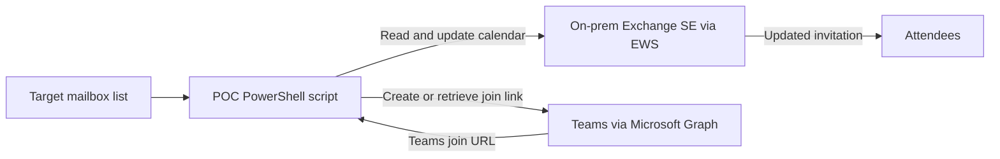

# Webex-to-Teams Meeting URL POC

This project is a proof of concept for replacing Webex join links in selected meeting invitations with Microsoft Teams join links. It targets a hybrid environment where Exchange Server Subscription Edition hosts the mailboxes on premises and users are synchronized to Microsoft Entra ID.

## What it does

The PowerShell script uses two services:

1. **Exchange Web Services (EWS)** reads the organizer's on-premises calendar and updates eligible meeting bodies.
2. **Microsoft Graph** creates or retrieves a Teams online meeting for the organizer and returns its join URL.

The script inserts the Teams join link into the existing invite, replaces the single detected Webex URL, and sends an updated meeting request to attendees.



## Important behavior

Graph's `onlineMeeting:createOrGet` creates a standalone meeting that does not appear on the organizer's calendar. The script updates the existing on-prem Exchange event separately through EWS. This POC therefore changes the invitation's join instructions; it does not create a fully calendar-backed Teams meeting or migrate Webex meeting IDs, dial-in details, registration, recordings, attendance data, or policies. See [Microsoft Graph `createOrGet`](https://learn.microsoft.com/en-us/graph/api/onlinemeeting-createorget?view=graph-rest-1.0).

The included script processes organizer-owned, non-cancelled single meetings and recurring series with exactly one Webex URL in the item's body. For a recurring series, it binds to and updates the series master once, so the series uses one shared Teams URL. It skips attendee copies, events with multiple or no Webex URLs, and events that already contain a Teams join URL. A modified occurrence (an exception) can have its own invite body; the script flags such series but does not rewrite exception bodies independently. Review those exceptions manually after applying, along with generated invite content and any Webex-specific instructions that remain in the body.

The recurring series uses a standalone Graph meeting object. Microsoft documents a 60-day expiry after the meeting start/end that can be extended by updating or activating the meeting before expiry. Validate long recurring gaps over 60 days separately; they may require a refreshed link. [Graph onlineMeeting lifetime](https://learn.microsoft.com/en-us/graph/api/resources/onlinemeeting?view=graph-rest-1.0)

## Project files

| File | Description |
| --- | --- |
| `README.md` | Project overview and quick-start guidance. |
| `POC-Webex-to-Teams-Meeting-URL.md` | Detailed requirements, permission setup, Exchange scoping, runbook, validation steps, and rollback instructions. |
| `scripts/Convert-WebexMeetingsToTeams.ps1` | Script with `Preview`, `Apply`, and `Rollback` modes. |
| `scripts/New-TargetsCsv.ps1` | Resolves pilot SMTP addresses to Entra object IDs and writes `targets.csv`. |
| `pilot-mailboxes.csv` | Input template for pilot mailbox SMTP addresses and optional Entra UPNs. |
| `targets.csv` | Output template consumed by the meeting conversion script. |

## Requirements and permissions

- Exchange SE hybrid deployment with EWS reachable over HTTPS from the script runner. HMA supports EWS, but the script still needs an authentication method accepted by the EWS endpoint. The included example uses Windows authentication and a dedicated service account. See [HMA protocol support](https://learn.microsoft.com/en-us/microsoft-365/enterprise/configure-exchange-server-for-hybrid-modern-authentication).
- The EWS service account must have the Exchange `ApplicationImpersonation` role scoped to pilot mailboxes. Do not grant unscoped impersonation for this POC.
- A single-tenant Entra app registration with a certificate and Microsoft Graph **application** permission `OnlineMeetings.ReadWrite.All`, with admin consent.
- For the POC, create a self-signed certificate in `Cert:\CurrentUser\My` while signed in as the Windows account that will run the script; upload only its public `.cer` to the app registration and pass its thumbprint to the script. The detailed generation, upload, and app-only connection check are in [the runbook](POC-Webex-to-Teams-Meeting-URL.md). Use your organization's PKI process for production.
- A Teams application access policy assigned only to pilot organizers. Graph requires this policy when application permission is used to create meetings on behalf of users.
- To generate the target list, an interactive delegated Graph lookup using `User.ReadBasic.All`. This read-only permission is used only by the helper script, not by the POC meeting creation app. [Graph list users permissions](https://learn.microsoft.com/en-us/graph/api/user-list?view=graph-rest-1.0)
- Pilot organizers synchronized to Entra ID and enabled/licensed for Teams.
- Windows PowerShell 5.1, the approved EWS Managed API 2.2 assembly, and the `Microsoft.Graph.Authentication` and `Microsoft.Graph.Users` modules.
- Populate `pilot-mailboxes.csv` with each organizer's SMTP address. If it differs from the Entra UPN, supply the UPN in the second column:

```csv
MailboxSmtp,EntraUserPrincipalName
pilot.organizer@contoso.com,
```

Generate `targets.csv` by running the resolver. It signs in interactively, looks up each user, and exports `MailboxSmtp,EntraObjectId`. The existing POC app permissions remain unchanged.

```powershell
Install-Module Microsoft.Graph.Authentication -Scope CurrentUser
Install-Module Microsoft.Graph.Users -Scope CurrentUser
.\scripts\New-TargetsCsv.ps1 -InputCsv ".\pilot-mailboxes.csv" -OutputCsv ".\targets.csv" -Force
```

The resolver requires delegated `User.ReadBasic.All` to read basic user profiles; Microsoft documents that this profile includes `id`, `mail`, and `userPrincipalName`. [Graph user-list permissions](https://learn.microsoft.com/en-us/graph/api/user-list?view=graph-rest-1.0), [basic profile properties](https://learn.microsoft.com/en-us/graph/permissions-reference)

The meeting-conversion script does not need Graph calendar or mail permissions. The separate target resolver uses only delegated read-only `User.ReadBasic.All`. For Teams' native calendar integration with on-premises mailboxes, there are additional hybrid, published EWS/Autodiscover, and OAuth prerequisites; see Microsoft's [Teams and Exchange integration requirements](https://learn.microsoft.com/en-us/microsoftteams/exchange-teams-interact).

## Quick start

First, follow the detailed [POC runbook](POC-Webex-to-Teams-Meeting-URL.md) to register the Graph app, scope Exchange impersonation, assign the Teams application access policy, prepare the certificate, and confirm EWS connectivity.

### Preview

Preview reads meetings and writes a report. It does not call Graph or update Exchange.

```powershell
$ewsCredential = Get-Credential "CONTOSO\svc_webex_teams_poc"

.\scripts\Convert-WebexMeetingsToTeams.ps1 `
  -Mode Preview `
  -EwsUrl "https://mail.contoso.com/EWS/Exchange.asmx" `
  -EwsManagedApiDll "C:\Program Files\Microsoft\Exchange\Web Services\2.2\Microsoft.Exchange.WebServices.dll" `
  -EwsCredential $ewsCredential `
  -TargetsCsv ".\targets.csv" `
  -WindowStartUtc "2026-11-03T00:00:00Z" `
  -WindowEndUtc "2026-11-17T00:00:00Z" `
  -ReportPath ".\preview.csv"
```

### Apply

After reviewing the preview, use a one-organizer CSV for the first apply. Add the Graph tenant ID, app client ID, certificate thumbprint, and a new backup path. The script creates/reuses the Teams meeting, backs up the original invite body, updates Exchange, and sends the attendee update.

```powershell
.\scripts\Convert-WebexMeetingsToTeams.ps1 `
  -Mode Apply `
  -EwsUrl "https://mail.contoso.com/EWS/Exchange.asmx" `
  -EwsManagedApiDll "C:\Program Files\Microsoft\Exchange\Web Services\2.2\Microsoft.Exchange.WebServices.dll" `
  -EwsCredential $ewsCredential `
  -TargetsCsv ".\targets-one.csv" `
  -WindowStartUtc "2026-11-03T00:00:00Z" `
  -WindowEndUtc "2026-11-17T00:00:00Z" `
  -GraphTenantId "<TENANT-ID>" `
  -GraphAppId "<GRAPH-APP-CLIENT-ID>" `
  -GraphCertificateThumbprint "<CERTIFICATE-THUMBPRINT>" `
  -BackupPath ".\teams-poc-backup-20261102-120000.jsonl" `
  -ReportPath ".\apply.csv"
```

### Rollback

Rollback restores the original meeting body from the JSONL backup and sends another meeting update. It does not delete the standalone Teams online meeting object. Protect the backup because it contains original meeting body text.

```powershell
.\scripts\Convert-WebexMeetingsToTeams.ps1 `
  -Mode Rollback `
  -EwsUrl "https://mail.contoso.com/EWS/Exchange.asmx" `
  -EwsManagedApiDll "C:\Program Files\Microsoft\Exchange\Web Services\2.2\Microsoft.Exchange.WebServices.dll" `
  -EwsCredential $ewsCredential `
  -BackupPath ".\teams-poc-backup-20261102-120000.jsonl" `
  -ReportPath ".\rollback.csv"
```

## Validation checklist

1. Start with one organizer and one future, single-instance meeting with a test attendee.
2. Review the `Preview` report and confirm the intended Webex URL is the only match.
3. Apply the change and confirm the Teams URL appears in the organizer's Exchange event.
4. Confirm the attendee receives the updated invite and can join the Teams meeting.
5. Repeat with a simple recurring series without modified occurrences and confirm the master update reaches multiple occurrences. If `HasModifiedOccurrences` is true, inspect and update each exception invite manually; the script only edits the recurring master.
6. Check lobby, anonymous-join, and external attendee behavior against Teams meeting policies.
7. Test rollback before widening the pilot.

For the complete procedure, troubleshooting notes, and cleanup commands, use the [detailed runbook](POC-Webex-to-Teams-Meeting-URL.md).
