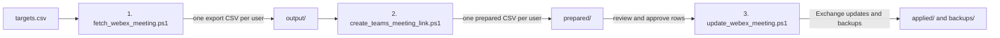

# Webex-to-Teams Meeting URL POC

This proof of concept finds Webex links in organizer-owned meetings in on-premises Exchange SE, creates Teams meeting links, and updates the existing Exchange invitations. It is designed for a classic hybrid deployment with users synchronized to Microsoft Entra ID and HMA enabled.

## Three-stage workflow



1. **Fetch:** `fetch_webex_meeting.ps1` reads the targeted users' calendars through EWS and creates `output/<email>-webex-export.csv` for each user. It is read-only. Review statuses, meeting subjects, Webex URL diagnostics, MTIDs, and recurrence details.
2. **Create Teams links:** `create_teams_meeting_link.ps1` reads the export CSVs, creates or retrieves links for eligible rows through Graph, and writes `prepared/<email>.csv`. It does not change Exchange. Review the prepared files and set `ApprovedForUpdate` to `Yes` only for the rows to apply.
3. **Update:** `update_webex_meeting.ps1` reads selected prepared CSVs and updates only rows with `Status=ReadyForUpdate` and `ApprovedForUpdate=Yes`. It writes result CSVs under `applied/` and a JSONL backup under `backups/`.

The prepared CSV is the handoff and approval artifact. Keep the same files between review and update. Do not edit the mailbox, item ID, change key, selected Webex URLs, or Teams URL fields. The update script checks the EWS change key and confirms the selected URL is still present before making a change.

Stage 1 and stage 2 stop if their output files already exist; use a new output directory or pass `-Force` when you intentionally want to replace them. Replacing a prepared file resets its approval values, so review it again. Stage 3 requires a new backup path for every apply run; `-Force` only allows replacing result CSVs.

## What the scripts change

The scripts process organizer-owned, non-cancelled single meetings and recurring series. For recurring meetings, they update the series master once; a series with modified occurrences is flagged because exception invite bodies may still need manual review. The scripts prefer Webex `j.php?MTID=...` join links and group URL variants with the same MTID. Other Webex URLs, such as `globalcallin.php`, remain untouched. Ambiguous join URLs require manual review. CSV reports contain meeting URLs and MTIDs; protect them as sensitive data.

Graph `onlineMeeting:createOrGet` creates a standalone Teams online meeting that does not appear on the organizer's calendar. EWS updates the existing on-premises calendar item with the Teams URL and sends a meeting update to attendees. This replaces meeting join instructions; it does not migrate Webex IDs, dial-in details, recordings, attendance data, or Webex policy settings. Validate the standalone Teams meeting behavior with a pilot organizer. Recurring links also need review if the series has a gap longer than the Graph online meeting's documented lifetime.

## Requirements and permissions

- Windows PowerShell 5.1 on a machine that can reach the on-premises EWS endpoint over HTTPS. The EWS scripts default to `-EwsProxyMode Direct`; use `System` or `SystemDefaultCredentials` only when the route requires a proxy.
- EWS Managed API 2.2 assembly and a dedicated EWS service account with `ApplicationImpersonation` scoped to the targeted mailboxes.
- A single-tenant Entra app with Microsoft Graph **application** permission `OnlineMeetings.ReadWrite.All`, admin consent, and a Teams application access policy scoped to the organizers. Certificate and client-secret authentication are supported; certificates are recommended for production.
- Organizers synchronized to Entra ID, enabled and licensed for Teams, with their Entra object IDs in `targets.csv`.
- PowerShell modules `Microsoft.Graph.Authentication` and `Microsoft.Graph.Users`. The latter is used only by the target-file helper.
- EWS credentials and (when used) the Graph client secret are encrypted with Windows DPAPI in `%LOCALAPPDATA%\WebexTeamsPOC`. The cache is usable only by the same Windows user on the same computer. The Graph secret is prompted once and cached after a successful connection.

The POC app does not need Graph calendar or mail permissions. HMA supports EWS but does not itself grant mailbox access. See [the runbook](POC-Webex-to-Teams-Meeting-URL.md) for certificate generation, scoped permissions, credential cache handling, and troubleshooting.

## Prepare the target list

Create `pilot-mailboxes.csv` with SMTP addresses and, when needed, the Entra UPN:

```csv
MailboxSmtp,EntraUserPrincipalName
pilot.organizer@contoso.com,
```

Resolve the Entra object IDs into `targets.csv`:

```powershell
Install-Module Microsoft.Graph.Authentication -Scope CurrentUser
Install-Module Microsoft.Graph.Users -Scope CurrentUser
.\scripts\New-TargetsCsv.ps1 -InputCsv ".\pilot-mailboxes.csv" -OutputCsv ".\targets.csv" -Force
```

The helper uses delegated, read-only `User.ReadBasic.All`. The meeting creation app uses the object IDs from the CSV and does not need directory read permission.

## Run the three stages

Run each stage in the project directory from Windows PowerShell 5.1. Keep the target file and UTC window consistent. For the first end-to-end test, put one test organizer in `targets.csv`; after it succeeds, add the remaining approved organizers and rerun with `-Force` for stages 1 and 2 so their per-user files are refreshed.

```powershell
$ewsUrl = "https://mail.contoso.com/EWS/Exchange.asmx"
$ewsDll = "C:\Program Files\Microsoft\Exchange\Web Services\2.2\Microsoft.Exchange.WebServices.dll"
$batchStart = [DateTimeOffset]::UtcNow
$batchEnd = $batchStart.AddDays(30)
```

### 1. Fetch Webex meeting details

```powershell
.\scripts\fetch_webex_meeting.ps1 `
  -EwsUrl $ewsUrl `
  -EwsManagedApiDll $ewsDll `
  -TargetsCsv ".\targets.csv" `
  -WindowStartUtc $batchStart `
  -WindowEndUtc $batchEnd `
  -OutputDirectory ".\output"
```

The first run prompts for the EWS service-account credential and stores it in the encrypted cache. Review each `output\<email>-webex-export.csv`. Only rows with `Status=ReadyForTeamsLink` proceed to Graph link creation. Resolve rows requiring manual URL review before continuing.

### 2. Create Teams links and prepare review files

Certificate authentication (default):

```powershell
.\scripts\create_teams_meeting_link.ps1 `
  -InputDirectory ".\output" `
  -OutputDirectory ".\prepared" `
  -GraphTenantId "<TENANT-ID>" `
  -GraphAppId "<GRAPH-APP-CLIENT-ID>" `
  -GraphAuthMethod Certificate `
  -GraphCertificateThumbprint "<CERTIFICATE-THUMBPRINT>"
```

For a client secret, use `-GraphAuthMethod ClientSecret` and omit the certificate thumbprint. The script securely prompts on first use and caches the secret encrypted for this Windows account and computer. Keep the secret out of commands, scripts, CSVs, and logs.

Open each `prepared\<email>.csv` and review the Webex URL diagnostics, subject, time, recurrence status, and `TeamsJoinUrl`. Set `ApprovedForUpdate` to `Yes` for each meeting you approve; leave all other rows as `No`. Save the reviewed CSV before stage 3. Graph creates standalone meeting objects, so unused links may remain if you decide not to apply a prepared row.

### 3. Update the approved meetings in Exchange

To update one selected user's file, set the pattern to that prepared filename. Use `*.csv` only when applying all reviewed files:

```powershell
.\scripts\update_webex_meeting.ps1 `
  -EwsUrl $ewsUrl `
  -EwsManagedApiDll $ewsDll `
  -InputDirectory ".\prepared" `
  -FilePattern "pilot.organizer@contoso.com.csv" `
  -OutputDirectory ".\applied" `
  -BackupPath ".\backups\pilot-update.jsonl"
```

The script updates only approved `ReadyForUpdate` rows. Rows that are not approved are reported as `AwaitingApproval`. Changed EWS items and URLs no longer present are skipped for review. Attendees receive an updated meeting request. The backup contains original body and Location content; protect it.

To roll back from the JSONL backup, run:

```powershell
.\scripts\update_webex_meeting.ps1 `
  -Mode Rollback `
  -EwsUrl $ewsUrl `
  -EwsManagedApiDll $ewsDll `
  -BackupPath ".\backups\pilot-update.jsonl" `
  -OutputDirectory ".\applied" `
  -Force
```

Rollback restores the saved body and Location when they still match the post-update values and sends another attendee update. It does not delete the Graph online meeting object.

## Project files

| File | Purpose |
| --- | --- |
| `scripts/fetch_webex_meeting.ps1` | Stage 1: EWS read and per-user Webex export CSVs. |
| `scripts/create_teams_meeting_link.ps1` | Stage 2: Graph link creation and prepared per-user CSVs. |
| `scripts/update_webex_meeting.ps1` | Stage 3: approved EWS updates, rollback, result reports, and backup. |
| `scripts/WebexTeams.Common.ps1` | Shared EWS, Graph, URL-selection, credential-cache, and file helpers. |
| `scripts/Report-WebexMeetingsInventory.ps1` | Separate read-only sizing report across mailbox types. |
| `scripts/New-TargetsCsv.ps1` | Resolves pilot SMTP addresses to Entra object IDs. |
| `scripts/Convert-WebexMeetingsToTeams.ps1` | Legacy combined workflow; use the three stage scripts above for new runs. |
| `POC-Webex-to-Teams-Meeting-URL.md` | Detailed setup and operations runbook. |
